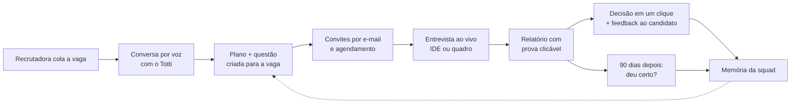

<div align="center">

# Totti

### O entrevistador técnico que pensa junto, prova o que diz e aprende com cada contratação.

**A gente otimiza o custo da entrevista e, principalmente, o resultado da contratação.**

Converge Challenge powered by Tako · Porto Digital · Recife · novembro de 2026

</div>

---

## Dois ganhos num produto só

### 1. A entrevista técnica sai do calendário do time

Hoje cada entrevista técnica consome horas de um engenheiro sênior ou de um tech lead: preparar o exercício, entrevistar, escrever o parecer. Multiplique por dezenas de candidatos por vaga, e o time para de entregar para contratar. Enquanto isso, a vaga fica aberta e o candidato bom aceita outra proposta.

**O Totti faz a entrevista no lugar dele.** O candidato escolhe o horário, o Totti conduz a sessão inteira por voz, com o mesmo critério para todos, e o relatório fica pronto minutos depois. O time só entra para conversar com os finalistas. **Menos custo por entrevista, vaga fechada mais rápido e nenhum candidato esperando semanas por retorno.**

### 2. E, além disso, menos contratação errada

Fazer a entrevista mais barata e mais rápida já paga o produto. Mas o erro mais caro de um processo seletivo não é a entrevista: **é contratar a pessoa errada.** E é aqui que o Totti vai além.

Uma contratação errada numa vaga de backend pleno custa algo em torno de **R$ 50 mil**: três meses de salário e encargos até o fim da experiência, o processo refeito do zero e o onboarding e as entregas que se perdem no caminho (estimativa; a conta está em [docs/plano-diferencial.md](docs/plano-diferencial.md)).

Ver se o código passou não diz como a pessoa vai agir quando o requisito mudar na sexta à tarde, quando travar num bug ou quando precisar de ajuda. **O Totti foi feito para medir exatamente isso**, e para aprender, contratação após contratação, o que dá certo no seu time.

Os dois ganhos valem o mesmo: um corta o custo de cada entrevista, o outro evita o prejuízo de cada erro.

## O que é o Totti

O Totti é um agente de IA que cuida da triagem técnica de uma vaga de tecnologia de ponta a ponta:

1. **Conversa por voz com a recrutadora** e transforma o que ela quer, dito do jeito dela, num plano de entrevista.
2. **Entrevista cada candidato ao vivo e por voz**, numa IDE de live coding ou num quadro de system design, acompanhando o código e o desenho em tempo real.
3. **Muda o problema no meio**, como acontece no trabalho, e mede como a pessoa se adapta.
4. **Entrega um relatório em que cada nota tem prova**: um clique abre o código daquele minuto e o que foi falado.
5. **Aprende com o time e com o resultado**: cada decisão da recrutadora e cada contratação avaliada aos 90 dias ajustam as próximas entrevistas daquela vaga.



---

## O que só o Totti faz

### 1. Monta a entrevista numa conversa, não num formulário

A recrutadora cola a descrição da vaga (ou solta um PDF, que é lido **no próprio navegador**: o arquivo não sai da máquina dela) e conversa por voz com o Totti.

- Antes de abrir a boca, o Totti já classificou a vaga: **formato** (live coding ou system design), **senioridade** e **quanto pesa cada área** (técnica, pressão, escala, uso de IA).
- Ele **não pergunta o que já sabe**. Quando tem certeza, propõe; quando a confiança é baixa, pergunta em vez de sugerir.
- Ele faz **uma pergunta que decide algo da avaliação** e pergunta **o que reprova direto**.
- Ele entende português falado de verdade: "uma hora e meia", "quarenta e cinco", "meia hora". E não confunde "3 milhões de transações" com a duração da entrevista.
- Se ela muda de ideia no meio ("na verdade, escala não importa tanto"), a última declaração vale, e a área sai do plano.
- Tom da entrevista, política de dicas e linguagens permitidas viram preferências estruturadas, que o resumo final reflete sem contradição.

O resultado é um plano com critérios e pesos que a recrutadora confirma. **Ninguém preenche formulário.**

### 2. Cria um problema novo para cada vaga

Para system design, quando o plano é confirmado, o Totti **escreve uma questão nova a partir da descrição da vaga** e do que foi combinado. Uma vaga de pagamentos ganha um problema de pagamentos, não um encurtador de URL genérico.

- **Todo candidato da mesma vaga resolve o mesmo problema**, então dá para comparar um com o outro.
- Confirmar o plano vale como **aprovação humana** do problema.
- A rubrica continua fixa e conhecida pelo avaliador: o que muda é o cenário, não a régua.

### 3. Uma conversa que não atropela quem está pensando

Entrevista técnica é cheia de pausa. "Deixa eu pensar…" não é fim de resposta. O Totti foi construído em cima disso:

- A fala do candidato só vai para o agente depois de **cerca de 3 segundos sem voz**. Menos que isso cortava quem só parou para pensar no meio da frase.
- Se o candidato continua falando enquanto o Totti prepara a resposta, **as duas partes viram um pedido só**. Nada de o Totti começar a responder a metade da frase e mudar de assunto no meio.
- Um "hm" solto não refaz a resposta do zero.
- Quando algo falha (a rede caiu, o modelo demorou), o Totti usa uma fala de reserva, e **o relatório sabe que foi falha do sistema**: um "pode repetir?" nunca conta contra o candidato.
- A voz ganha um respiro de silêncio nas pontas, para a primeira sílaba não ser engolida pelo fone Bluetooth.

### 4. A mão do Totti no quadro

No system design, o Totti não é só uma voz. Ele tem **um cursor com o nome dele**, como um colega no Figma, e usa o quadro enquanto fala:

- **aponta, sublinha, circula, enquadra, percorre e compara** as peças do desenho do candidato, e escreve anotações curtas;
- tudo **sincronizado com a voz**: a mão chega na peça na hora em que ele fala dela;
- os gestos ficam numa camada temporária. **O Totti nunca altera o desenho do candidato.**

O enunciado também é escrito no quadro, e cada requisito novo aparece ali.

### 5. Muda o problema no meio da entrevista

No trabalho, o requisito muda. Por isso o Totti traz **um empecilho** no meio da sessão e mede a reação.

- **Na IDE:** o requisito muda ou entra um caso novo ("pode ter mais de um par: devolva o que termina antes"). A mudança aparece fixa na tela, com **testes de verdade** marcados como "Mudança". Ela pode vir antes de o código funcionar.
- **No quadro:** com o desenho montado, numa pausa do candidato, ele traz uma mudança do problema: **volume 10x**, **grupos de 100 mil pessoas no chat**, **sistema externo fora do ar** nos pagamentos, **orçamento cortado pela metade**. Fala a mudança e escreve "Mudança: …" na lista de requisitos.
- O momento é escolhido com cuidado: só depois de o candidato ter uma direção, só se sobrar tempo para adaptar, e nunca em cima de uma fala.
- O relatório ganha o bloco **"Como se adaptou"**, com nota própria de 1 a 4, **fora da nota geral**, e provas tiradas só do que veio depois da mudança.

### 6. Mede como a pessoa aprende, não só se acertou

Travar não é ruim. Ruim é travar e não sair do lugar. O Totti mede isso **pelos fatos da sessão, não pela opinião do modelo**:

- **Travou:** duas execuções seguidas falhando sem avanço, ou dois minutos parado com o código falhando.
- **Destravou:** a primeira execução depois disso com mais testes passando que o melhor até ali.
- **Dicas em níveis:** o relatório mostra qual dica a pessoa precisou e quanto tempo levou para destravar depois dela.
- O modelo só julga **como** a pessoa usou a ajuda. Travar, destravar e adaptar são medidos por código.

A seção **"Aprendizado"** fica fora da nota geral: quem pediu ajuda não é punido. O relatório mostra como ela usou essa ajuda.

### 7. Não entrega a resposta, e não deixa ninguém espiar

- Cada pergunta do agente passa por um **filtro de spoiler** antes de chegar ao candidato.
- Os **testes escondidos rodam no servidor no fim da sessão e nunca vão para o navegador**. Os casos grandes rodam separados, com tempo próprio: força bruta estoura, hashmap passa.
- **Colagens são registradas** com tamanho e linha, e o Totti pode perguntar sobre o trecho que acabou de aparecer.
- O foco que a recrutadora pediu (pressão, escala, uso de IA) **ganha pergunta própria, decidida pelo código**: a distribuição segue os pesos combinados e não varia de uma entrevista para a outra.

### 8. Relatório em que cada nota tem prova

Nenhuma nota é de confiança cega.

- O relatório abre com o gráfico **"Como foi a entrevista"**: quanto dos testes passava a cada execução, com os acontecimentos escritos em cima ("Travou por 2 min" → "Dica 1 → destravou em 50 s" → "Mudança" → "Adaptou em 1 min 50 s").
- **Clicar num acontecimento, numa nota ou numa prova abre o código naquele minuto**, com as linhas que a pessoa tinha acabado de escrever marcadas, e a conversa em volta daquele momento. Uma régua deixa andar pela entrevista inteira.
- O veredito vem primeiro, depois os pontos fortes e de atenção, a linha do tempo em frases e as notas por critério.
- Quando um critério foi ajustado pelo time, o relatório mostra **"Critério aprendido com o time"**.

### 9. Decisão em um clique, e retorno para todo candidato

No fim do relatório, a recrutadora decide **Avançar** ou **Não avançar**. O candidato **recebe o feedback por e-mail**, avance ou não, e ninguém fica no vácuo. O motivo da decisão, quando ela escreve um, **ensina o Totti**.

### 10. Aprende o critério do time, com um guarda-corpo contra viés

Toda decisão da recrutadora ou do tech lead pode virar critério: um motivo como "propôs Kafka sem necessidade para esse volume" vira a regra **"Penaliza over-engineering"**, presa à decisão de onde veio.

- **No máximo 2 regras por decisão**, sempre com a origem visível ("Da reprovação de Rafael Moura · Backend Pleno").
- **Cada regra vale só na vaga de onde veio.** Vaga nova começa limpa.
- Na tela **"O que o Totti aprendeu"**, o time **edita, desliga ou apaga** qualquer regra. A tela mostra também a **concordância entre o Totti e o tech lead** vaga a vaga.
- **Guarda-corpo determinístico contra viés:** idade, formação ou faculdade, gênero e vida pessoal, sotaque e origem, aparência, raça e religião, deficiência e saúde, e impressão pessoal **nunca viram regra**. O filtro roda **antes** do modelo (o trecho nem chega a ele) e **depois** (regra que o modelo escreveu com esses termos é descartada). O time vê o que foi ignorado e por quê. Proteger o candidato não depende da boa vontade de um modelo.

### 11. Acompanha a contratação até o fim da experiência

As outras ferramentas param na contratação. O Totti vai até os **90 dias**, o fim da experiência CLT.

- A vaga que contratou ganha a aba **Contratações**: para cada pessoa contratada, lado a lado, **o que a entrevista disse e o que aconteceu de verdade**.
- O gestor responde em **3 toques**: deu certo? em que critério a entrevista errou? o que surpreendeu? (opcional).
- A resposta vira regra: "a entrevista deu 4 em casos de borda, e o pagamento duplicado em produção mostrou que não era" vira **"Casos de borda → mais rigor: quando esta vaga reabrir, o Totti pede para escrever o teste do caso de borda, não basta citar"**.
- No topo da aba fica o número que importa: **"2 de 3 aprovadas aos 90 dias"**.

É isso que um concorrente não copia: **a memória do seu time, calibrada pelo resultado real.**

---

## Antes e depois

| | Processo de hoje | Com o Totti |
|---|---|---|
| **Quem entrevista** | Horas de engenheiro sênior por candidato | O Totti; o time só conversa com os finalistas |
| **Tempo até o parecer** | Dias, esperando a agenda do entrevistador | Minutos depois da entrevista |
| **Configurar a vaga** | Formulário, rubrica genérica, reunião com o tech lead | Uma conversa por voz; o Totti propõe formato, nível e pesos |
| **O problema** | O mesmo exercício para qualquer vaga | Uma questão criada para a vaga, igual para todos os candidatos dela |
| **A entrevista** | Prova parada ou entrevistador sem tempo | Conversa ao vivo que espera quem pensa, aponta no desenho e lê o código |
| **O imprevisto** | Não existe | Um empecilho no meio, medido à parte |
| **Quem travou** | Perde ponto | Mostra quanto levou para destravar e com que ajuda |
| **A nota** | Um número sem contexto | Cada ponto abre o minuto exato do código e da conversa |
| **O candidato** | Fica sem retorno | Recebe feedback por e-mail |
| **Depois da contratação** | Ninguém volta para conferir | Aos 90 dias, o resultado recalibra a próxima entrevista |

---

## Princípios de engenharia

- **Determinístico onde importa.** Travar, destravar, adaptar, a cota de perguntas por foco, o guarda-corpo contra viés e a duração dita pela recrutadora são decididos por código testado. O modelo cuida da linguagem e do julgamento.
- **Nada é caixa-preta.** Cada nota tem prova, cada regra tem origem, e o time edita, desliga ou apaga o que o Totti aprendeu.
- **A falha é do sistema, nunca do candidato.** Fala de reserva não conta contra ninguém, e uma falha do modelo não trava a entrevista: há um provedor principal e um de reserva.
- **Privacidade por padrão.** Documentos da vaga são lidos no navegador. O código em C/C++ roda isolado, sem rede, sem fork e com limite de recursos. Os testes escondidos nunca saem do servidor.
- **Estado retomável.** O cérebro do quadro é uma máquina de estados em TypeScript puro, com estado em JSON, guardado no Supabase quando ele está configurado.

## Stack

- **Next.js 15** (App Router), **React 19**, **TypeScript**, **Tailwind 4**, **Motion**
- **Excalidraw** no quadro de system design, **Monaco** na IDE
- **Pyodide** para Python e clang/gcc em sandbox para C++
- **ElevenLabs** para a voz do Totti e a transcrição do candidato
- **Featherless** (principal) e **OpenRouter** (reserva) para os modelos de linguagem
- **TypeSafe AI (Jev)** para classificar a vaga e acompanhar a conversa com a recrutadora
- **Resend** e **React Email** para convites e feedback
- **Supabase** para persistência
- **Zod** nos contratos, **Playwright** e `node:test` nos testes

---

## Rodar localmente

Use Node 22 ou mais recente.

```bash
npm install
cp .env.example .env.local   # preencha as chaves que for usar
npm run dev                  # http://localhost:3000
```

Para ver as telas sem nenhuma chave:

```bash
NEXT_PUBLIC_USAR_SERVIDOR=0 AGENTE_FAKE=1 npm run dev
```

Nesse modo, a pré-entrevista e o quadro usam dados de demonstração, e o cérebro do system design usa um LLM falso determinístico.

### Onde está cada coisa

| Tela | Rota |
|---|---|
| Painel de vagas | `/vagas` |
| Nova vaga e conversa com o Totti | `/vagas/nova`, `/pre-entrevista` |
| O que o Totti aprendeu | `/vagas/aprendizado` |
| Agendamento do candidato | `/agendar/[token]` |
| Entrevista de live coding | `/entrevista` |
| Entrevista de system design | `/entrevista/system-design` |
| Relatório | `/report`, `/relatorio/[id]` |

### Variáveis de ambiente

O `.env.example` traz todas as variáveis, com comentários. As principais:

| Para quê | Variáveis |
|---|---|
| Agente da entrevista (LLM) | `FEATHERLESS_API_KEY` (principal), `OPENROUTER_API_KEY` (reserva) |
| Pré-entrevista (classificador e cobertura) | `TYPESAFE_API_KEY` |
| Voz e transcrição | `ELEVENLABS_API_KEY`, `ELEVENLABS_VOICE_ID` |
| E-mail dos convites | `RESEND_API_KEY`, `EMAIL_FROM`, `EMAIL_REPLY_TO`, `APP_URL` |
| Banco | `SUPABASE_URL`, `SUPABASE_SERVICE_ROLE_KEY` ([docs/supabase.md](docs/supabase.md)) |
| Testes e demonstração | `CANDIDATOS_TESTE`, `HORARIOS_DE_TESTE`, `AGENTE_FAKE`, `AGENTE_DEV`, `ARMAZENAMENTO` |

Sem as chaves do Supabase, os dados ficam em memória e na pasta `data/`. E-mail de verdade só sai para quem está em `CANDIDATOS_TESTE`.

## Testes

```bash
npm run lint
npx tsc --noEmit
npm run test:pre-entrevista   # planejador e falas do Totti
npm run test:agente           # cérebro do system design
npm run test:ide              # agente do live coding
npm run test:squad            # memória da squad e guarda-corpo
npm run test:noventa-dias     # ciclo dos 90 dias
npm run test:rotas            # rotas da API
npm run test:email            # templates e envio
npm run test:e2e              # Playwright (sobe o servidor sozinho)
```

A lista completa está no `package.json` (`test:*`, `eval:*`, `pre:*`).

## Estrutura

```
app/                rotas do Next.js (App Router) e a API em app/api
components/         telas: IDE, quadro, painel de vagas, relatório
lib/
  contracts.ts      contratos compartilhados (InterviewConfig, Report…). Mudou? Avise o time.
  pre-entrevista/   Totti com a recrutadora: classificação, conversa, cobertura e plano
  agents/           agente do live coding: leitura do código, empecilho, aprendizado, avaliação
  agente/           cérebro do system design: estado, perguntas, kits, questão da vaga e scorecard
  conversa/ audio/  turnos da conversa ao vivo e fila de falas
  presenca/         a mão do Totti no quadro: gestos, coreografia e sincronia com a voz
  vagas/ convites/  pipeline da vaga, candidatos, convites, agendamento e decisão
  email/            e-mails (React Email + Resend)
  squad-memory/     regras que o time ensina ao Totti e o guarda-corpo contra viés
  noventa-dias/     retorno pós-contratação que ajusta as regras
  voz/ transcricao/ fala do agente e transcrição do candidato
  storage/          Supabase ou memória
problems/           banco de problemas do live coding, com empecilhos e testes escondidos
fixtures/           vagas e dados de exemplo para testes e simulações
scripts/            simuladores, validações e utilitários
e2e/                testes Playwright e suas configs
docs/               documentação técnica (docs/arquivo guarda o material antigo do time)
```

## Documentação

- [Posicionamento e plano do diferencial](docs/plano-diferencial.md)
- [Supabase](docs/supabase.md): o que é guardado e como configurar
- [Integração de voz](docs/voz-integracao.md)
- [Contrato quadro ↔ cérebro](docs/contrato-quadro-cerebro.md) e [rotas do cérebro](docs/cerebro-rotas.md)
- [Geração de kits de avaliação](docs/geracao-de-kits.md)
- [Testar a entrevista por texto](docs/teste-local-entrevista-texto.md) e [testar o plano](docs/teste-local-plano.md)
- [Design](docs/design.md)

## Contribuindo

Cada pessoa trabalha numa branch própria (`nome/assunto`) e abre PR para a `main`. Antes do PR, rode `npm run lint`, `npx tsc --noEmit` e os testes da área que mudou. Depois do merge, apague a branch.
